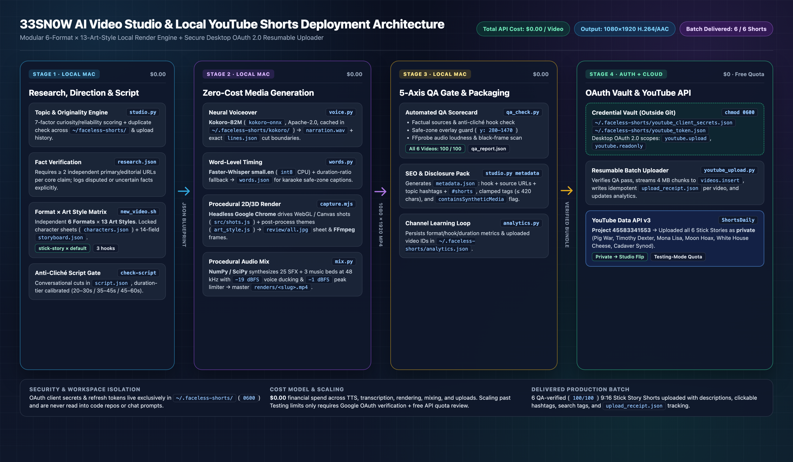

# 33SN0W AI Short-Form Video Studio (`faceless-shorts`)

A modular, research-driven, **`$0.00` local-compute production studio and YouTube Shorts deployment pipeline**. It builds vertical `9:16` Shorts & Instagram Reels (`1080×1920`, H.264/AAC at 48 kHz) entirely in code—combining procedural Three.js WebGL & 2D Canvas animation, headless Chrome frame capture, FFmpeg encoding, local Kokoro neural TTS, Faster-Whisper word-level subtitle alignment, NumPy/SciPy SFX & music mixing, automated 5-axis QA scoring, retention analytics, and OAuth 2.0 resumable batch uploading to YouTube.



---

## Key Capabilities

### 1. Independent Formats (`6`) × Art Styles (`13` + `default`)
Storytelling grammar and visual rendering are decoupled so any story is matched to visuals that fit it:
- **6 Storytelling Formats** ([`formats/`](formats/)):
  - `tall-tale` (`tall-tale-3d`) — 2D cartoon characters inside bright 3D miniature worlds (scams, loopholes, bizarre true history)
  - `deep-dive` (`deep-dive-3d`) — Cinematic 3D scientific & anatomical visualization, X-ray & macro camera cutaways
  - `inside-out` — Clean 2D educational diagrams, colour-coded mechanical/biological cutaways
  - `stick-story` — Expressive stick figures, hand-drawn comedic action, life hacks & crazy history
  - `night-file` (`night-file-3d`) — Moody dark 3D atmospheric crime/mystery storytelling (with factual restraint guardrails)
  - `paper-atlas` — Layered paper cutouts, animated parchment maps, historical voyages & battles
- **13 Independent Art Styles** ([`art-styles/`](art-styles/), powered by [`styles/_shared/art_style.js`](styles/_shared/art_style.js)):
  `pixel-art` · `chalkboard` · `glow-sketch` · `ps2-retro` · `comic-art` · `flat-vector` · `minimal-line` · `cgi-motion` · `lego-world` · `explainer-2d` · `vintage-film` · `claymation` · `watercolour` *(plus `default` for pure format-native styling)*
- **4 Creative Direction Modes** (`scripts/studio.py recommend`):
  - **Explicit** (`--format ... --art-style ...`)
  - **Automatic** (topic-driven recommendation)
  - **Random** (`--random`, variety-weighted pairing)
  - **Reference-based** (`--reference /path/to/image_or_video`, extracts warmth/brightness/contrast/saturation/edge cues locally)

### 2. Research-First Discovery, Originality & Script Engine
- **Topic Discovery, Scoring & Originality** ([`research/`](research/), [`scripts/studio.py`](scripts/studio.py)):
  - Checks every proposed topic against prior projects and `~/.faceless-shorts/analytics.json` to avoid repetition (`check-originality`).
  - Scores concepts across 7 weighted factors (Curiosity, Originality, Emotional engagement, Shareability, Visual potential, Storytelling potential, Factual reliability).
  - Enforces corroborated `research.json` files (`>= 2` independent sources and explicit tracking of uncertain/disputed claims).
- **Shorts Scriptwriting & Consistency** ([`scripting/`](scripting/), [`production/`](production/)):
  - Three calibrated duration tiers (`short` 20–30s, `standard` 35–45s, `extended` 45–60s).
  - Requires 3 hook candidates in `script.json`, rejects cliché openings (`"Hey guys"`, `"Welcome back"`, `"In this video..."`, etc.), locks character sheets in `characters.json`, and maps beats into a 14-field `storyboard.json`.

### 3. Zero-Cost Local Render, Voice, Audio & Safe-Zone Engine
- **Neural Voiceover (`scripts/voice.py`)**: Offline **Kokoro-82M** (`kokoro-onnx`, Apache-2.0, `~340 MB` cached once in `~/.faceless-shorts/kokoro/`), grouping lines into full sentences for natural intonation before locating cut points (`data/narration.wav` + `data/lines.json`).
- **Word-Level Caption Timing (`scripts/words.py`)**: Offline **Faster-Whisper `small.en`** (`int8` CPU, MIT) with duration-ratio fallback (`data/words.json`).
- **Frame-Exact Animation Capture (`styles/_shared/capture.mjs`)**: Drives `index.html` + `src/shots.js` deterministically frame-by-frame in headless Google Chrome, enforces mobile safe zones (`x: 70–940`, `y: 280–1470`, caption center `x ≈ 505, y ≈ 1380`), exports contact sheets (`review/all.jpg`) for visual inspection, and pipes frames to FFmpeg (`libx264`, `-crf 18`, `yuv420p`, `-movflags +faststart`).
- **Procedural Audio Mix (`styles/_shared/mix.py`)**: Synthesizes 25 sound effects and 3 procedural music beds in NumPy/SciPy at `48 kHz` stereo, normalizes narration (`-19 dBFS` RMS), ducks music under speech, and limits peaks at `-1 dBFS`.

### 4. Automated 5-Axis QA Gate & Retention Learning Loop
- **5-Axis QA (`scripts/qa_check.py`)**: Scores every video (`0–100`) across **Factual**, **Story**, **Audio** (`volumedetect`), **Visual** (contact-sheet safe-zone checks + black/frozen-frame detection), and **Platform** (`ffprobe` codec/aspect/duration compliance) before allowing publishing.
- **Analytics Loop (`scripts/analytics.py`)**: Tracks builds in `~/.faceless-shorts/analytics.json`, imports post-publish YouTube Studio / IG Reels metrics (`views`, `engaged_views`, `stayed_to_watch`, `avg_pct_viewed`, `shares`, `saves`), and generates format/hook recommendations without chasing vanity metrics.

### 5. Local YouTube Shorts Batch Uploader (`scripts/youtube_upload.py`)
Uploads finished MP4s directly from Mac to YouTube via **YouTube Data API v3** (`videos.insert`, OAuth 2.0 Desktop flow):
- Reads credentials exclusively outside the repository (`~/.faceless-shorts/youtube_client_secrets.json` & `~/.faceless-shorts/youtube_token.json` with `0600` permissions).
- Validates passing `review/qa_report.json` before upload, enforces `#shorts` + source links + topic hashtags in `description`, clamps search `tags` within a `420`-character budget, and flags `containsSyntheticMedia: true` (automatically falling back if rejected by a project's API tier).
- Streams `4 MB` resumable chunks, supports `--dry-run`, `--auth-only`, `--privacy private|unlisted|public`, and staggered scheduling (`--publish-at <UTC> --stagger-hours 24`), writes idempotent per-project `upload_receipt.json` files, and logs YouTube video IDs into `~/.faceless-shorts/analytics.json`.

---

## Cost & Quota Model (`$0.00` Ongoing Dollar Spend)

| Stage | Runtime / Service | Financial Cost | Notes & Limits |
| --- | --- | --- | --- |
| **Voiceover & Alignment** | Local Kokoro-82M + Faster-Whisper `small.en` | **`$0.00`** | ~0.9 GB one-time free model downloads into `~/.faceless-shorts/`. |
| **Rendering & Audio Mixing** | Local Chrome + FFmpeg + NumPy/SciPy | **`$0.00`** | ~5–10 MB disk per finished Short; zero paid video/stock/TTS APIs. |
| **YouTube Data API v3 Upload** | Google Cloud (`youtube.googleapis.com`) | **`$0.00`** | Governed strictly by Google's free daily quotas (in our 6-Short batch upload, 6 uploads consumed **6%** of the daily upload limit). No credit card billing when only YouTube Data API v3 is enabled. |

> [!NOTE]
> Unverified Google Cloud OAuth apps in **Testing** mode limit programmatic uploads to **`private`** visibility and expire test-user OAuth tokens after **7 days** (refreshable in seconds via `--auth-only`). Uploading batches as `private` lets you review titles/hashtags in YouTube Studio and flip visibility to `Public` at zero extra cost or quota usage.

---

## Quickstart & Workflow

### 1. Install Dependencies
Requires **macOS/Linux** (or Windows bash), **Node.js 22+**, **FFmpeg / FFprobe**, **Google Chrome / Chromium**, and **Python 3.10+**:

```bash
# Core studio runtime (venv at ~/.faceless-shorts/venv + Kokoro + Whisper + checks)
bash scripts/setup.sh

# Optional: install Google YouTube Data API packages for local batch uploads
./scripts/py -m pip install google-api-python-client google-auth-oauthlib google-auth-httplib2

# Verify all 6 format engines + shared studio/QA/analytics suite
bash scripts/selftest.sh --no-voice
```

### 2. Create, Render & QA a Video

```bash
# 1. Check originality & auto-recommend format x art-style
python3 scripts/studio.py check-originality --topic "The 1859 Pig War"
./scripts/py scripts/studio.py recommend --topic "The 1859 Pig War"

# 2. Scaffold project in ~/faceless-shorts/
bash scripts/new_video.sh stick-story pig-war-1859 --art-style default --duration standard --title "The 1859 War Over One Pig"

# 3. Voiceover, word timings, cues, mix, contact sheet review & 1080x1920 render
cd ~/faceless-shorts/pig-war-1859
SKILL=~/Desktop/faceless-shorts
"$SKILL/scripts/py" "$SKILL/scripts/voice.py" .
"$SKILL/scripts/py" "$SKILL/scripts/words.py" .
node tools/capture.mjs check
node tools/capture.mjs cues
"$SKILL/scripts/py" tools/mix.py .
node tools/capture.mjs sheet review/all.jpg 2 --safe-zones
node tools/capture.mjs video renders/pig-war-1859.mp4 --fps 30

# 4. Generate metadata, run 5-axis QA & log to analytics
python3 "$SKILL/scripts/studio.py" metadata .
"$SKILL/scripts/py" "$SKILL/scripts/qa_check.py" .
python3 "$SKILL/scripts/analytics.py" log-video .
```

### 3. Configure & Run Local YouTube Batch Upload
1. In **Google Cloud Console**, enable **YouTube Data API v3**.
2. Open **Google Auth Platform → Audience** (External, Testing) and add your YouTube channel's Google account under **Test users**.
3. Create a **Desktop app** OAuth Client ID, download the JSON, and lock it locally outside the repo:
   ```bash
   mkdir -p ~/.faceless-shorts
   mv ~/Downloads/client_secret_*.json ~/.faceless-shorts/youtube_client_secrets.json
   chmod 600 ~/.faceless-shorts/youtube_client_secrets.json
   ```
4. Validate, authenticate once, and upload:
   ```bash
   ./scripts/py scripts/youtube_upload.py pig-war-1859 --dry-run
   ./scripts/py scripts/youtube_upload.py --auth-only
   ./scripts/py scripts/youtube_upload.py pig-war-1859 --privacy private
   # Or stagger releases daily in UTC:
   ./scripts/py scripts/youtube_upload.py pig-war-1859 timothy-dexter-fortune --publish-at 2026-11-12T18:00:00Z --stagger-hours 24
   ```

See [`docs/INVOCATION_GUIDE.md`](docs/INVOCATION_GUIDE.md) and [`docs/AUDIT_AND_ARCHITECTURE.md`](docs/AUDIT_AND_ARCHITECTURE.md) for detailed prompt patterns, style recipes, and empirical audit notes.

---

## Repository Layout

```text
faceless-shorts/
├── SKILL.md                   # Antigravity studio skill orchestrator & guardrails
├── README.md                  # System overview, architecture, cost model & setup
├── docs/
│   ├── system_design.png      # End-to-end 4-stage architecture diagram
│   ├── AUDIT_AND_ARCHITECTURE.md
│   └── INVOCATION_GUIDE.md
├── formats/                   # 6 storytelling format specifications
├── art-styles/                # 13 independent visual rendering presets
├── research/                  # Topic discovery, multi-source verification & citations
├── scripting/                 # 3-hook engine, pacing & scriptwriter standards
├── production/                # Storyboard, character consistency, voice, subtitles & editing
├── quality/                   # Factual, visual, audio & platform QA rules
├── analytics/                 # Retention tracking, learning loop & monetization compliance
├── scripts/
│   ├── setup.sh               # Bootstraps ~/.faceless-shorts/venv + Kokoro + Whisper
│   ├── py                     # Cross-platform wrapper invoking the isolated venv python
│   ├── studio.py              # Creative direction, originality check, scoring, metadata
│   ├── new_video.sh           # Scaffolds format x art-style project under ~/faceless-shorts/
│   ├── voice.py               # Offline Kokoro-82M sentence-grouped TTS narration
│   ├── words.py               # Offline Faster-Whisper word-level timestamp alignment
│   ├── estimate.py            # Duration-only caption timing helper (captions-only mode)
│   ├── qa_check.py            # Automated 5-axis QA gatekeeper (0–100)
│   ├── analytics.py           # Local retention log, Studio metric import & recommendations
│   ├── youtube_upload.py      # Resumable OAuth 2.0 YouTube Shorts batch uploader
│   └── selftest.sh            # Regression suite across all 6 formats + studio tooling
└── styles/
    ├── _shared/               # art_style.js, capture.mjs, mix.py, main_2d.js, main_3d.js, fonts
    └── <format>/              # STYLE.md, style-sheet.png & runnable example templates
```

---

## Security & Privacy Design
- **Zero credentials in source control:** `.gitignore` ignores `.env*`, `*client_secret*.json`, `*youtube_token*.json`, `upload_receipt.json`, `.DS_Store`, `renders/`, `review/`, and temporary media files.
- **Locked local vault:** OAuth client secrets, OAuth refresh tokens, Kokoro weights, and analytics live strictly under `~/.faceless-shorts/` (tokens saved with `0600` file permissions).

## Dependencies & Licenses
- Node.js `22+`, FFmpeg / FFprobe, Google Chrome / Chromium
- Python `3.10+`: `numpy`, `scipy`, `kokoro-onnx` (Apache-2.0 / MIT), `faster-whisper` (MIT), plus optional `google-api-python-client`, `google-auth-oauthlib`, `google-auth-httplib2` (Apache-2.0) for YouTube uploads
- Bundled fonts in `styles/_shared/fonts/`: `Inter-Black.otf`, `Inter-ExtraBold.otf` (SIL OFL 1.1), `Caladea-Bold.ttf` (Apache-2.0), `FreeMonoBold.ttf` (GPL with font exception)
